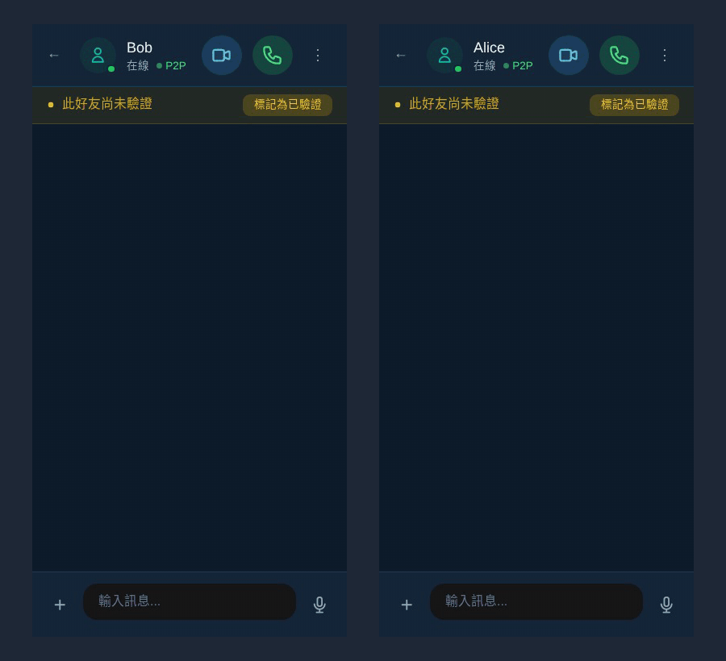
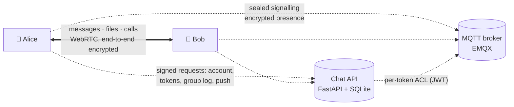

  

<h1 align="center">AegisTalk Chat</h1>

  <b>End-to-end encrypted chat and calls that go straight from phone to phone — on a server you run yourself.</b>

  <a href="README.md">繁體中文</a> ｜ <b>English</b>

<!-- DEMO GIF SLOT (≤ 30 s). It MUST be recorded in step 9 from the REAL running app (two devices or browsers) against a
     LOCAL self-hosted server set up with docs/SELF_HOSTING.md — no mock-ups, no staged screens, no edited timing.
     Save it as docs/assets/demo.gif and replace the placeholder paragraph below with:
     

 -->

<i>Demo recording: to be added.</i>

## Features

- **Phone to phone** — messages, files and calls travel directly between devices over WebRTC. No TURN relay, no copy on the server.
- **Encrypted, signalling included** — X3DH + Double Ratchet in a Rust → WebAssembly core; call setup is sealed and signed, and a call connects only after both sides' DTLS fingerprints match.
- **Groups the server cannot rewrite** — membership is a signed commit chain that every member checks; the server only puts it in order.
- **No phone number, no e-mail** — your account is a key on your phone, unlocked with a local PIN.
- **Your server** — one FastAPI service and an EMQX broker, invite-only by default, Web Push built in.

## How it works

The chat server has two parts: an API that keeps keys-only accounts, issues broker tokens, stores the group logs and
sends pushes, and an MQTT broker that relays sealed signalling envelopes and encrypted presence. Message content never
goes through either: phones queue messages locally and deliver them over a direct WebRTC DataChannel when both are
online ([SELF_HOSTING](docs/SELF_HOSTING.md#what-a-server-consists-of), `packages/pwa/src/services/p2pSend.ts`).

## Install

- **Android** — download the APK from [Releases](../../releases/latest) and open it (allow "install unknown apps" when asked).
- **Web (PWA)** — open the web app that your server hosts and add it to the home screen ([SELF_HOSTING](docs/SELF_HOSTING.md#pointing-the-apps-at-your-server)).
- **Your own server** — [docs/SELF_HOSTING.md](docs/SELF_HOSTING.md): docker compose or bare metal, behind a TLS reverse proxy.
- **iOS** — planned for v1.1.

On first launch the app asks which server to use, then you set a PIN, choose a name and register (with an invite code
if the server requires one); the server can be changed later in Settings. A new phone takes over from the old one by
device transfer; for a lost phone, keep the offline recovery kit the app lets you create in Settings (a file protected
by a passphrase; the server keeps no copy).

The Android app is the community flavour: "AegisTalk Chat (community)", application id `com.aegisrd.talk.community`
(self-hosters can build it under their own id and name; [SELF_HOSTING · Android app](docs/SELF_HOSTING.md#android-app-community-flavour)).

## What is in this repository — and what is not

| In this repository | Not in this repository |
|---|---|
| The chat app: React + TypeScript PWA, Android shell (Capacitor) | The AI anti-fraud engine (models, rules, keywords, scanning, risk scoring). Its warning components ship but are **inert**: nothing feeds them |
| The end-to-end encryption core (`packages/crypto-core`, Rust → WASM, built from source) | Face-based identity, guardian / family check-in, payments and network protection of the official app |
| The chat server (`api/chat_app.py`, `api/chat/`, `api/group_log_routes.py`) | The official service's deployment and configuration |
| Broker policy, compose example, smoke test (`emqx/`, `docker-compose.example.yml`, `scripts/selfhost/`) | The iOS app (v1.1) |
| Tests, mutation runners and a four-phone adversarial simulator (`scripts/review/`, `scripts/sim/`) | |

## What the server still sees

End-to-end encryption hides content, not everything. Whoever runs the server (the operator) can see:

- **Your public key, your IP address and when you are connected.** An account is an Ed25519 identity key mapped to a
  random account id; the key appears in your broker topics and token ([SELF_HOSTING · Accounts](docs/SELF_HOSTING.md#accounts),
  [MQTT_BROKER §4](docs/MQTT_BROKER.md#4-token-內容apichatmqtt_authpy)).
- **Who sends to whom, when and roughly how much.** Every sealed envelope shows sender, recipient and an outer
  timestamp; sizes are padded to buckets (1 KB / 16 KB / 64 KB …); a call is visible as a burst of request, accept,
  offer/answer and ICE envelopes ([DIRECT_SEALED §2](docs/DIRECT_SEALED.md#2-the-envelope), [§7](docs/DIRECT_SEALED.md#7-threat-model)).
- **Your friend list.** Presence topics carry the owner's key, so the broker sees who subscribes to whose presence,
  and the rhythm of your presence updates (on connect, every 4 minutes while connected, on disconnect); only the
  encrypted state inside is hidden ([W4 · Limits](docs/GROUP_LOG_WIRING_W4.md#limits-by-design-or-for-later-steps)).
- **The shape of your groups.** Who subscribes to which group topic and when topics change (about the member count and
  the times keys rotate); a group's topics are linkable through the client id. The group log shows group id, sequence
  numbers, entry sizes, timing, the key epoch of each entry and which account appended it; an operator of both the log
  and the broker can match topics to group ids by timing ([W3 · Limits](docs/GROUP_LOG_WIRING_W3.md#limits-by-design-or-for-later-steps),
  [W1 · Residual risks](docs/GROUP_LOG_WIRING_W1.md#residual-risks-of-the-log-model)).
- **Push metadata.** For each push: sender, recipient, whether it is a call and whether it is a video call; the Web Push
  endpoints of each account. A push carries no text ([DIRECT_SEALED §6–§7](docs/DIRECT_SEALED.md#6-names-receipts-pushes),
  [SELF_HOSTING · Push](docs/SELF_HOSTING.md#push-notifications-optional)).
- **Friend codes and session setup.** A short friend code's public key, pre-key and display name for 24 hours; the outer
  fields of `X3DH_INIT` (ephemeral key, signed pre-key, session-reset flag) ([SELF_HOSTING · Data](docs/SELF_HOSTING.md#data-on-disk-and-backups),
  [DIRECT_SEALED §7](docs/DIRECT_SEALED.md#7-threat-model)).
- **Your active device** and device-transfer tokens ([SELF_HOSTING · Known limits](docs/SELF_HOSTING.md#known-limits)).

Not on the server: message, file and call content; names and avatars (sealed profiles); call SDP, IP addresses and
fingerprints exchanged during call setup (sealed); group names, rosters and roles (inside the encrypted group log);
group ids on the broker; the content of presence updates (encrypted; the connection times above remain visible)
([DIRECT_SEALED §1](docs/DIRECT_SEALED.md#1-what-changed), [W3](docs/GROUP_LOG_WIRING_W3.md), [W4](docs/GROUP_LOG_WIRING_W4.md)).

Because connections are direct, **your contacts' devices and the STUN servers see your IP address**. If a server lists
no STUN servers, the app uses public ones (`packages/pwa/src/services/iceServers.ts`).

## What the operator can do

The design assumes a hostile operator who can read, drop, delay, replay, reorder and inject any broker message, lie
about the time and run the push and log servers ([DIRECT_SEALED §7](docs/DIRECT_SEALED.md#7-threat-model)). Such an
operator **can**:

- **Block or delay anything** — messages, connections, group-log entries, keys. The app then shows "waiting" or
  "offline"; it never falls back to an old key, a forged member or plaintext ([W5 §5](docs/GROUP_LOG_WIRING_W5.md#5-limits-by-design-or-for-later)).
- **Show different group logs to different members** — detected as a warning in the group, not prevented; a member the
  operator isolates completely stays on an old view ([W1 · Residual risks](docs/GROUP_LOG_WIRING_W1.md#residual-risks-of-the-log-model),
  [W5 §3 S12](docs/GROUP_LOG_WIRING_W5.md#3-attacks-and-results)).
- **Shift the clock within limits** — short-lived checks accept at most ±5 minutes of server clock difference (the app
  warns when the phone's time is off), but a withheld, never-seen call request can be delivered later and ring
  ([DIRECT_SEALED §7](docs/DIRECT_SEALED.md#7-threat-model), [W5 §1.1](docs/GROUP_LOG_WIRING_W5.md#11-w4-leftovers)).
- **Hold back a friend's genuine call push and deliver it a few minutes late** — the phone rings for a call that was
  really made, at most about 15 minutes after it, once per call; it cannot invent one (a full-screen ring with a name needs
  the caller's signed ring token; [DIRECT_SEALED §4](docs/DIRECT_SEALED.md#push-ring-caller-signed-ring-token)).
- **Force a session reset with a friend** by forging an `X3DH_INIT` — a denial of service, no content
  ([DIRECT_SEALED §7](docs/DIRECT_SEALED.md#7-threat-model)).
- **Answer a short friend code with a different key.** Short codes are looked up on the server
  (`api/chat/shortcode.py`); a QR code scanned in person carries the key itself
  (`packages/pwa/src/components/Verification/QRCodeVerification.tsx`).
- **Decide who may register, and create accounts.** Any account can subscribe to any well-formed topic (it gets only
  ciphertext and timing), append junk to the log of a group whose id it knows (members skip it) and fill someone's
  offline queue up to its limit ([MQTT_BROKER §5](docs/MQTT_BROKER.md#5-已知限制), [W5 §6](docs/GROUP_LOG_WIRING_W5.md#6-open-items-and-later-changes),
  [SELF_HOSTING · Known limits](docs/SELF_HOSTING.md#known-limits)).
- **Clear or withhold presence** — friends then see you offline, or still online for at most 10 minutes after you leave
  ([W4 · Limits](docs/GROUP_LOG_WIRING_W4.md#limits-by-design-or-for-later-steps)).

It **cannot** read content, forge messages, members, admin actions or keys, impersonate you in signalling, put itself
in the middle of a call or DataChannel without the fingerprint check failing, or forge your online state
([DIRECT_SEALED §7](docs/DIRECT_SEALED.md#7-threat-model), [W5 §3](docs/GROUP_LOG_WIRING_W5.md#3-attacks-and-results),
[W4](docs/GROUP_LOG_WIRING_W4.md)).

## Known limits

- **Both devices must be online at the same time** for a message to arrive; the sender's phone queues it until then
  (`packages/pwa/src/services/p2pSend.ts`).
- **No TURN relay:** two networks that block every direct connection cannot connect ([SELF_HOSTING · Known limits](docs/SELF_HOSTING.md#known-limits)).
- **Forged `X3DH_INIT`** can reset a session with an existing friend (above).
- A full-screen ring with the caller's name needs the caller's signed ring token; a phone whose clock is more than 5 minutes
  off, or a call push without a valid token, gets a plain notification instead (the in-app ring is unaffected)
  ([DIRECT_SEALED §4](docs/DIRECT_SEALED.md#push-ring-caller-signed-ring-token)).
- Control frames such as `seed_sync` ride the verified DataChannel without extra signing; device-transfer message types
  are unchanged ([DIRECT_SEALED §7](docs/DIRECT_SEALED.md#7-threat-model)).
- After a device transfer the old phone wipes itself without waiting for the new phone to confirm
  ([MQTT_BROKER §5](docs/MQTT_BROKER.md#5-已知限制)).
- Right after a key rotation, a "delete for everyone" or call control can miss members that switch to the new group
  topic late; group state is not affected. Every rotation makes online members reconnect once
  ([W3 · Limits](docs/GROUP_LOG_WIRING_W3.md#limits-by-design-or-for-later-steps)).
- A phone whose clock is more than 5 minutes off loses group calls and online dots until it uses automatic time
  ([W5 §5](docs/GROUP_LOG_WIRING_W5.md#5-limits-by-design-or-for-later)).
- Members of a shared group who are not friends see each other online ([W5 §5](docs/GROUP_LOG_WIRING_W5.md#5-limits-by-design-or-for-later)).
- Above 50 groups, the least active groups miss group control messages until they become active again
  ([MQTT_BROKER §5](docs/MQTT_BROKER.md#5-已知限制)).

## Roadmap

- [ ] iOS app (v1.1)
- [ ] Optional server-held backup, sealed by the user (the server stores only ciphertext)
- [ ] `X3DH_INIT` for existing friends bound to the identity signature (no forged session resets)
- [ ] Member-held append token for the group log, so outsiders cannot write junk
- [ ] Hide the friend graph from the broker (optional hardening)

Changes per release: [CHANGELOG.md](CHANGELOG.md).

## Building from source

Node.js 20+, Rust (rustup) with `wasm-pack` 0.13.1 for the encryption core, Python 3.12 for the server, Android
Studio for the Android app. Step by step: [CONTRIBUTING.md](CONTRIBUTING.md). The encryption core builds
reproducibly: [packages/crypto-core/README.md](packages/crypto-core/README.md).

Tests: `npm test` runs the whole review suite (`scripts/review/run-all.mjs`; `--mutants` adds the mutation runners),
`scripts/sim/local-run.sh` the four-phone adversarial simulation, and `scripts/selfhost/conformance.sh` checks the
docker compose stack end to end ([SELF_HOSTING · Running the tests](docs/SELF_HOSTING.md#running-the-tests)).

| Path | What |
|---|---|
| `packages/pwa` | The app — React PWA, Android via Capacitor |
| `packages/crypto-core` | X3DH + Double Ratchet core (Rust → WebAssembly) |
| `api` | Chat server (`chat_app.py`, `chat/`, `group_log_routes.py`) |
| `emqx`, `docker-compose.example.yml` | Broker policy and an example stack |
| `scripts/selfhost`, `scripts/review`, `scripts/sim` | Smoke test and compose conformance run, tests and mutation runners, adversarial simulator |
| `docs` | Self-hosting, broker, sealed signalling and group-log design notes |

## Contributing

Issues and pull requests are welcome — see [CONTRIBUTING.md](CONTRIBUTING.md); commits need a DCO sign-off
(`git commit -s`). Please report security problems
privately as described in [SECURITY.md](SECURITY.md).

## License

[MIT](LICENSE). Third-party components: [THIRD_PARTY_NOTICES.md](THIRD_PARTY_NOTICES.md).

The MIT License covers the code, not the names AegisTalk and 安心說 or the logo. If you publish your own build, give
it a different name, icon and application id — see [TRADEMARKS.md](TRADEMARKS.md).
