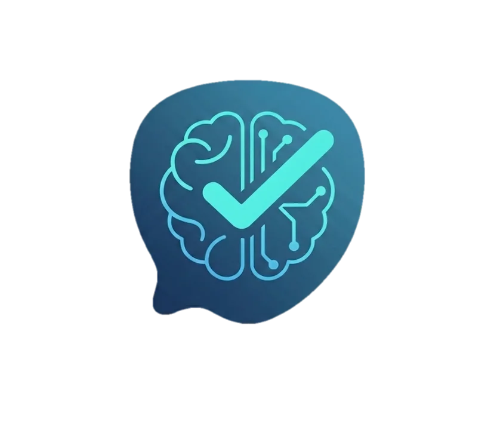
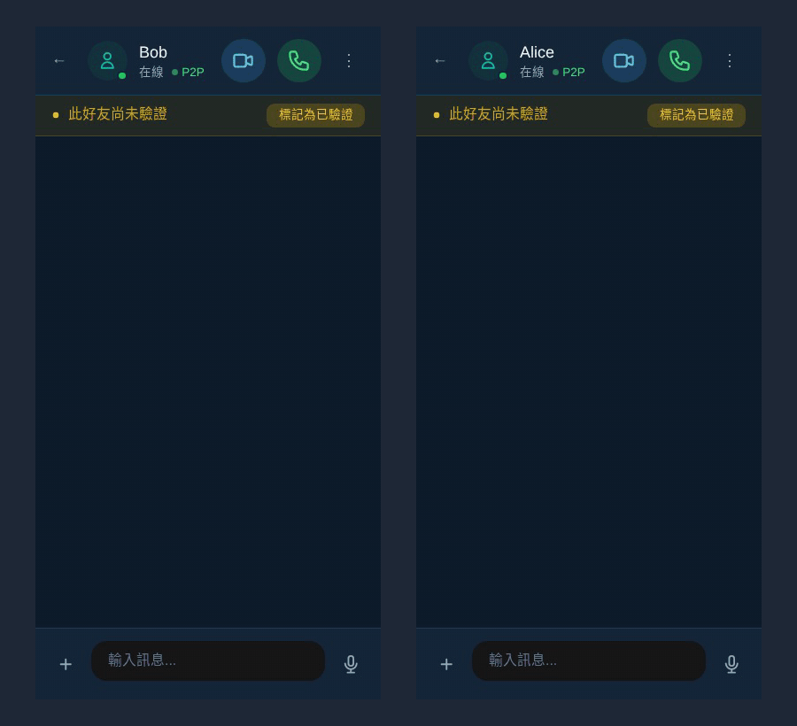
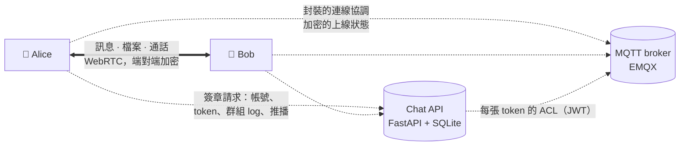
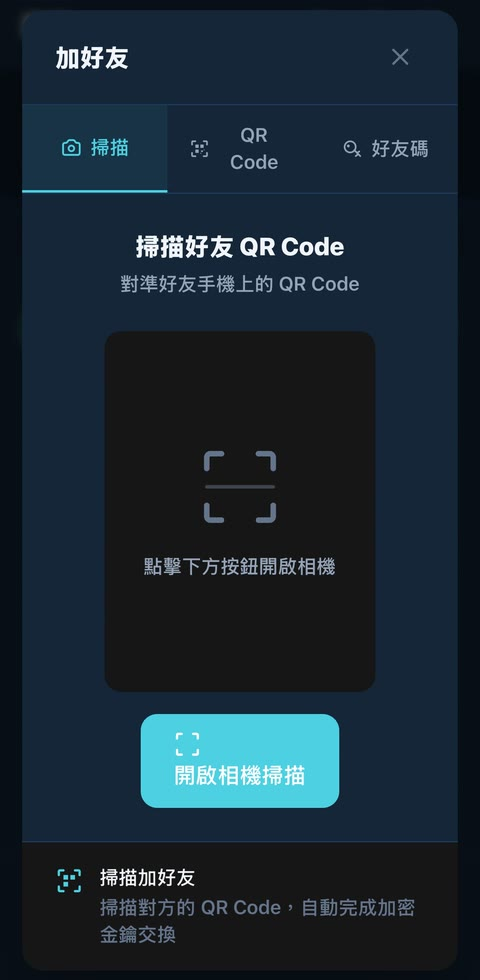

  

<h1 align="center">安心說 AegisTalk Chat</h1>

  <b>端對端加密的聊天與通話，直接從手機到手機——伺服器由你自己架。</b>

  <b>繁體中文</b> ｜ <a href="README.en.md">English</a>

> **English** — AegisTalk Chat is an end-to-end encrypted chat and call app (Android + web) whose messages go phone
> to phone, with a small server you run yourself. MIT. Full English README: [README.en.md](README.en.md).

實際的社群版網頁版，在兩個手機大小的瀏覽器視窗裡連本機自架的伺服器錄製：Alice 傳訊息、Bob 回覆、Alice 傳照片，最後 Alice 打電話給 Bob。

## 功能

- **手機直連**：訊息、檔案和通話透過 WebRTC 在裝置之間直接傳送。沒有 TURN 中繼，伺服器上也沒有副本。
- **連線協調也加密**：X3DH 與 Double Ratchet，加密核心以 Rust 寫成並編譯為 WebAssembly；通話的連線協調訊息會封裝並簽章，雙方的 DTLS 指紋對上才會接通。
- **伺服器改不了的群組**：成員名單是一條每位成員都會自己驗證的簽章鏈，伺服器只負責排順序。
- **不用電話號碼、不用 email**：帳號就是手機上的一把金鑰，用本機 PIN 碼解鎖。
- **你自己的伺服器**：一個 FastAPI 服務加一個 EMQX broker，預設只收邀請註冊，內建 Web Push。

## 運作方式

chat 伺服器分兩部分：API 負責只有金鑰的帳號、發 broker 的 token、保存群組 log、發推播；MQTT broker 轉送封裝過的連線協調訊息和加密的上線狀態。訊息內容兩邊都不經過：手機先把訊息排在本機，等雙方都上線時，透過直接的 WebRTC DataChannel 送達（[SELF_HOSTING](docs/SELF_HOSTING.md#what-a-server-consists-of)、`packages/pwa/src/services/p2pSend.ts`）。

## 安裝

- **Android**：到 [Releases](../../releases/latest) 下載 APK 並開啟（系統詢問時，允許「安裝不明應用程式」）。
- **網頁版（PWA）**：打開你的伺服器提供的網頁版，加到主畫面（[SELF_HOSTING](docs/SELF_HOSTING.md#pointing-the-apps-at-your-server)，英文）。
- **自己架伺服器**：[docs/SELF_HOSTING.md](docs/SELF_HOSTING.md)（英文）：docker compose 或直接裝在主機上，前面放一個 TLS 反向代理。
- **iOS**：預計 v1.1。

第一次開啟時，App 會先問要用哪一台伺服器，接著設定 PIN 碼、取名字、註冊（伺服器要求的話，要輸入邀請碼）；之後可以在設定裡換伺服器。換新手機時由舊手機轉移資料；手機遺失時，要靠你事先在 App 的設定裡做好的離線恢復包（用密語保護的檔案，伺服器上沒有備份）。

加好友在「加好友」視窗，有三個分頁：掃描對方手機上的 QR Code、顯示自己的 QR Code 讓對方掃，或輸入對方分享的好友碼。用好友碼加的好友會標成「未驗證」，之後當面掃 QR Code 就能升級。

Android App 是社群版：「AegisTalk Chat (community)」，application id `com.aegisrd.talk.community`（自架的人可以用自己的
id 與名稱建置；[SELF_HOSTING · Android app](docs/SELF_HOSTING.md#android-app-community-flavour)，英文）。

## 這個 repo 有什麼、沒有什麼

| 這個 repo 裡有 | 這個 repo 裡沒有 |
|---|---|
| 聊天 App：React + TypeScript 的 PWA，Android 外殼（Capacitor） | AI 防詐引擎（模型、規則、關鍵字、掃描、風險評分）。警示畫面元件有附上，但**不會作用**：沒有任何東西餵資料給它 |
| 端對端加密核心（`packages/crypto-core`，Rust → WASM，從原始碼建置） | 官方 App 的刷臉身分、家人守護／報平安、支付與網路防護 |
| chat 伺服器（`api/chat_app.py`、`api/chat/`、`api/group_log_routes.py`） | 官方服務的部署與設定 |
| broker 設定、compose 範例、冒煙測試（`emqx/`、`docker-compose.example.yml`、`scripts/selfhost/`） | iOS App（v1.1） |
| 測試、突變測試和四支手機的攻擊模擬（`scripts/review/`、`scripts/sim/`） | |

## 伺服器還看得到什麼

端對端加密藏住的是內容，不是全部。架伺服器的人（營運方）看得到：

- **你的公鑰、IP 位址和你什麼時候在線。** 帳號是一把 Ed25519 身分金鑰，對應到一個隨機的帳號 id；這把金鑰會出現在你的 broker 主題和 token 裡（[SELF_HOSTING · Accounts](docs/SELF_HOSTING.md#accounts)、[MQTT_BROKER §4](docs/MQTT_BROKER.md#4-token-內容apichatmqtt_authpy)）。
- **誰傳給誰、什麼時候、大概多少。** 每個封裝信封都看得到寄件人、收件人和外層時間；大小會補到固定的幾級（1 KB／16 KB／64 KB…）；一通電話看起來是一串請求、接聽、offer/answer 和 ICE 信封（[DIRECT_SEALED §2](docs/DIRECT_SEALED.md#2-the-envelope)、[§7](docs/DIRECT_SEALED.md#7-threat-model)）。
- **你的好友名單。** 上線狀態的主題帶著主人的金鑰，所以 broker 看得到誰訂了誰的上線狀態，以及你更新上線狀態的節奏（連上時、連著時每 4 分鐘、斷線時）；只有裡面加密的狀態看不到（[W4 · Limits](docs/GROUP_LOG_WIRING_W4.md#limits-by-design-or-for-later-steps)）。
- **群組的輪廓。** 誰訂了哪個群組主題、主題什麼時候換（大約看得出人數和換金鑰的時間）；同一個群組的主題可以透過 client id 串起來。群組 log 看得到群組 id、序號、每筆大小、時間、每筆的金鑰世代，以及是哪個帳號寫入的；同時經營 log 和 broker 的人，可以靠時間把主題和群組 id 對起來（[W3 · Limits](docs/GROUP_LOG_WIRING_W3.md#limits-by-design-or-for-later-steps)、[W1 · Residual risks](docs/GROUP_LOG_WIRING_W1.md#residual-risks-of-the-log-model)）。
- **推播的中繼資料。** 每則推播的寄件人、收件人、是不是來電、是不是視訊；每個帳號的 Web Push 端點。推播本身不帶文字（[DIRECT_SEALED §6–§7](docs/DIRECT_SEALED.md#6-names-receipts-pushes)、[SELF_HOSTING · Push](docs/SELF_HOSTING.md#push-notifications-optional)）。
- **好友短碼與建立 session。** 好友短碼背後的公鑰、預備金鑰和顯示名稱，保留 24 小時；`X3DH_INIT` 的外層欄位（臨時金鑰、signed pre-key、重設 session 的旗標）（[SELF_HOSTING · Data](docs/SELF_HOSTING.md#data-on-disk-and-backups)、[DIRECT_SEALED §7](docs/DIRECT_SEALED.md#7-threat-model)）。
- **你目前使用的裝置**和裝置轉移用的 token（[SELF_HOSTING · Known limits](docs/SELF_HOSTING.md#known-limits)）。

伺服器上沒有的：訊息、檔案和通話內容；名字和頭像（封裝的個人資料）；建立通話時交換的 SDP、IP 位址和指紋（封裝）；群組名稱、成員和角色（在加密的群組 log 裡）；broker 上的群組 id；上線狀態的內容（加密；上面說的連線時間還是看得到）（[DIRECT_SEALED §1](docs/DIRECT_SEALED.md#1-what-changed)、[W3](docs/GROUP_LOG_WIRING_W3.md)、[W4](docs/GROUP_LOG_WIRING_W4.md)）。

因為是直連，**你的聯絡人的裝置和 STUN 伺服器看得到你的 IP 位址**。如果伺服器沒有提供 STUN 伺服器，App 會用公開的 STUN（`packages/pwa/src/services/iceServers.ts`）。

## 營運方能做什麼

設計上假設營運方是敵對的：能讀、擋、延後、重放、調換順序、注入任何 broker 訊息，能謊報時間，也經營推播和 log 伺服器（[DIRECT_SEALED §7](docs/DIRECT_SEALED.md#7-threat-model)）。這樣的營運方**做得到**：

- **擋掉或延後任何東西**：訊息、連線、群組 log、金鑰。App 會顯示「等待中」或「離線」，絕不會退回舊金鑰、假成員或明文（[W5 §5](docs/GROUP_LOG_WIRING_W5.md#5-limits-by-design-or-for-later)）。
- **給不同成員看不同的群組 log**：會被偵測到、在群組裡顯示警告，但擋不住；被營運方完全隔離的成員會停在舊的狀態（[W1 · Residual risks](docs/GROUP_LOG_WIRING_W1.md#residual-risks-of-the-log-model)、[W5 §3 S12](docs/GROUP_LOG_WIRING_W5.md#3-attacks-and-results)）。
- **在範圍內撥動時鐘**：短時間的檢查最多只採信 ±5 分鐘的伺服器時鐘差（手機時間不準時 App 會提醒），但可以把一通扣住、從沒送達過的來電請求晚點再送，手機一樣會響（[DIRECT_SEALED §7](docs/DIRECT_SEALED.md#7-threat-model)、[W5 §1.1](docs/GROUP_LOG_WIRING_W5.md#11-w4-leftovers)）。
- **把好友真的來電推播扣住、晚幾分鐘再送**：手機會為一通真的打過的電話響，最晚大約 15 分鐘後、每通一次；捏造不出來（全螢幕響鈴、顯示名字要有來電者簽章的響鈴 token，[DIRECT_SEALED §4](docs/DIRECT_SEALED.md#push-ring-caller-signed-ring-token)）。
- **偽造 `X3DH_INIT` 強迫你和好友重設 session**：讓人用不了，但拿不到內容（[DIRECT_SEALED §7](docs/DIRECT_SEALED.md#7-threat-model)）。
- **好友短碼回給你另一把金鑰。** 短碼是在伺服器上查的（`api/chat/shortcode.py`）；當面掃 QR code 則是 QR 本身就帶著金鑰（`packages/pwa/src/components/Verification/QRCodeVerification.tsx`）。
- **決定誰能註冊，也能自己開帳號。** 任何帳號都能訂閱任何形狀正確的主題（只拿得到密文和時間）、往知道 id 的群組 log 寫垃圾（成員會跳過）、把某人的離線佇列塞到上限（[MQTT_BROKER §5](docs/MQTT_BROKER.md#5-已知限制)、[W5 §6](docs/GROUP_LOG_WIRING_W5.md#6-open-items-and-later-changes)、[SELF_HOSTING · Known limits](docs/SELF_HOSTING.md#known-limits)）。
- **清掉或扣住上線狀態**：好友會看到你離線，或在你離開後最多 10 分鐘內還以為你在線（[W4 · Limits](docs/GROUP_LOG_WIRING_W4.md#limits-by-design-or-for-later-steps)）。

它**做不到**：讀內容；偽造訊息、成員、管理員操作或金鑰；在連線協調裡冒充你；在指紋檢查不失敗的情況下夾在通話或 DataChannel 中間；偽造你的上線狀態（[DIRECT_SEALED §7](docs/DIRECT_SEALED.md#7-threat-model)、[W5 §3](docs/GROUP_LOG_WIRING_W5.md#3-attacks-and-results)、[W4](docs/GROUP_LOG_WIRING_W4.md)）。

## 已知限制

- **兩台裝置要同時在線**訊息才送得到；在那之前由寄件人的手機排著（`packages/pwa/src/services/p2pSend.ts`）。
- **沒有 TURN 中繼**：兩邊的網路如果都擋掉直連，就連不起來（[SELF_HOSTING · Known limits](docs/SELF_HOSTING.md#known-limits)）。
- **偽造的 `X3DH_INIT`** 可以重設和既有好友的 session（見上）。
- 全螢幕響鈴、顯示來電者名字要有來電者簽章的響鈴 token；手機時鐘差超過 5 分鐘，或來電推播沒有有效的 token，只會收到一則一般通知（App 裡的來電不受影響）（[DIRECT_SEALED §4](docs/DIRECT_SEALED.md#push-ring-caller-signed-ring-token)）。
- `seed_sync` 這類控制訊息走已驗證的 DataChannel，沒有另外簽章；裝置轉移的訊息型別沒有改（[DIRECT_SEALED §7](docs/DIRECT_SEALED.md#7-threat-model)）。
- 裝置轉移完成後，舊手機不等新手機確認就會自己清掉（[MQTT_BROKER §5](docs/MQTT_BROKER.md#5-已知限制)）。
- 剛換完金鑰的那幾秒，「為所有人刪除」或通話控制可能漏掉比較晚切到新群組主題的成員；群組狀態不受影響。每次換金鑰，線上的成員都會重連一次（[W3 · Limits](docs/GROUP_LOG_WIRING_W3.md#limits-by-design-or-for-later-steps)）。
- 手機時鐘差超過 5 分鐘時，群組通話和上線綠點會失效，直到改回自動時間（[W5 §5](docs/GROUP_LOG_WIRING_W5.md#5-limits-by-design-or-for-later)）。
- 同一個群組裡不是好友的成員，彼此看得到對方在線（[W5 §5](docs/GROUP_LOG_WIRING_W5.md#5-limits-by-design-or-for-later)）。
- 超過 50 個群組時，最不活躍的那幾個群會收不到群組控制訊息，直到它們又有動靜（[MQTT_BROKER §5](docs/MQTT_BROKER.md#5-已知限制)）。

## 路線圖

- [ ] iOS App（v1.1）
- [ ] 選用的伺服器備份，由使用者自己封裝（伺服器只存密文）
- [ ] 既有好友的 `X3DH_INIT` 綁身分簽章（不能再偽造重設 session）
- [ ] 群組 log 的成員寫入 token，讓外人寫不進垃圾
- [ ] 對 broker 藏起好友關係（選用的加強）

各版本變更：[CHANGELOG.md](CHANGELOG.md)（英文）。

## 從原始碼建置

需要 Node.js 20 以上；加密核心需要 Rust（rustup）與 `wasm-pack` 0.13.1；伺服器需要 Python 3.12；Android App 需要 Android Studio。步驟見 [CONTRIBUTING.md](CONTRIBUTING.md)（英文）。加密核心可重現建置：[packages/crypto-core/README.md](packages/crypto-core/README.md)。

測試：`npm test` 跑全部的審查測試（`scripts/review/run-all.mjs`；加 `--mutants` 連突變測試一起跑），`scripts/sim/local-run.sh` 跑四支手機的攻擊模擬，`scripts/selfhost/conformance.sh` 把 docker compose 整組架起來從頭到尾檢查一遍（[SELF_HOSTING · Running the tests](docs/SELF_HOSTING.md#running-the-tests)，英文）。

| 路徑 | 內容 |
|---|---|
| `packages/pwa` | App 本體：React PWA，Android 用 Capacitor |
| `packages/crypto-core` | X3DH 與 Double Ratchet 加密核心（Rust → WebAssembly） |
| `api` | chat 伺服器（`chat_app.py`、`chat/`、`group_log_routes.py`） |
| `emqx`、`docker-compose.example.yml` | broker 設定與範例組合 |
| `scripts/selfhost`、`scripts/review`、`scripts/sim` | 冒煙測試與 compose 整組檢查、測試與突變測試、攻擊模擬 |
| `docs` | 自架、broker、封裝連線協調與群組 log 的設計說明 |

## 參與貢獻

歡迎開 issue 或送 pull request，請先看 [CONTRIBUTING.md](CONTRIBUTING.md)（英文）；每個 commit 都要加 DCO 簽署（`git commit -s`）。資安問題請依 [SECURITY.md](SECURITY.md) 私下回報，不要公開開 issue。

## 授權

[MIT](LICENSE)。第三方元件：[THIRD_PARTY_NOTICES.md](THIRD_PARTY_NOTICES.md)。

MIT 授權只涵蓋程式碼，不包括「AegisTalk」「安心說」名稱與標誌。如果你要發布自己建置的版本，請改用其他名稱、圖示和 application id，詳見 [TRADEMARKS.md](TRADEMARKS.md#名稱與標誌)。
